# Отчёт по лабораторной работе №2 (Node-RED)

## Что сделано

В ходе работы я освоила Node-RED как low-code инструмент для визуального программирования. Установила Node-RED через Docker Desktop с volume, настроила порт 1880, создала 12 потоков (flow-01 … flow-12), охватывающих все обязательные ноды из задания. Каждый поток сохранён отдельным JSON-файлом в папке `lab2/flows/`, скриншоты — в `lab2/screenshots/`.

## Способ установки и версии

- **Способ**: Docker Desktop (образ `nodered/node-red:latest`).
- **Порт**: 1880.
- **Volume**: локальная папка `lab2/data` → `/data` в контейнере.

**Команда запуска:**

```
docker run -d --name node-red-lab2 -p 1880:1880 -v "//c/Users/USER/Desktop/visual-programming-labs-Sevashko/lab2/data:/data" nodered/node-red:latest
```

- **Node-RED version**: v5.0.8
- **Node.js version**: v24.21.0

## Использованные AI-промпты

Несколько ключевых примеров:

1. «Сгенерируй JavaScript-код для function node Node-RED, в котором используются let/const, if/else, цикл for, массив и объект. Функция должна возвращать объект с полем payload».
2. «Сгенерируй Mustache-шаблон для template node Node-RED, который формирует JSON из объекта с полями name, age, city».
3. «Как настроить http request node Node-RED для получения случайной шутки из публичного API api.chucknorris.io?».
4. «Как сделать счётчик в flow context Node-RED, который живёт между сообщениями?».
5. «Как настроить Node-RED в Docker с volume, чтобы данные сохранялись между перезапусками контейнера?».

## Освоенные ноды

- **Базовые**: inject, debug, function, switch, change, template.
- **Сетевые**: http request, http in, http response, mqtt in, mqtt out.
- **Dashboard**: gauge, chart (пакет node-red-dashboard).
- **Telegram**: telegram receiver, telegram sender (пакет node-red-contrib-telegrambot).
- **Работа с файлами**: write file, read file.
- **Контекст**: работа с flow.get() и flow.set() внутри function.

## Скриншоты всех flow

### 2.1 Inject → Debug
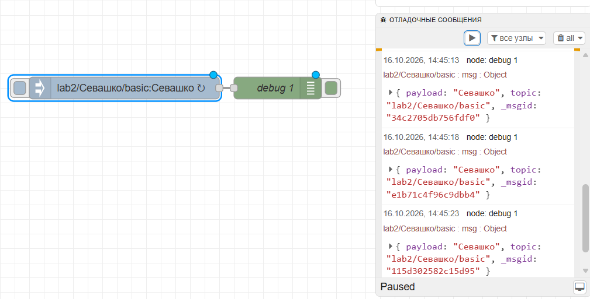

### 2.2 Function
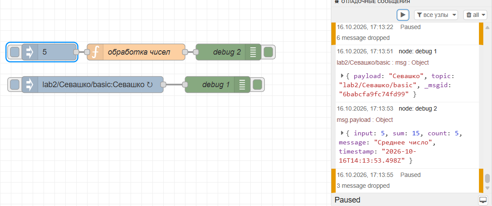

### 2.3 Switch
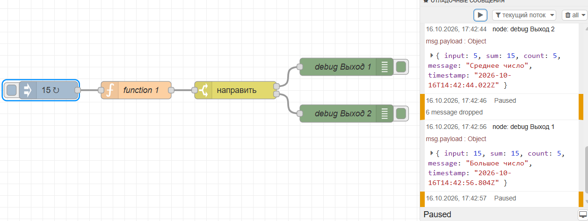

### 2.4 Change
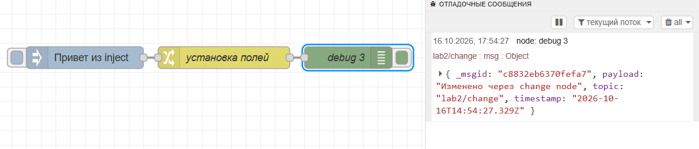

### 2.5 Template
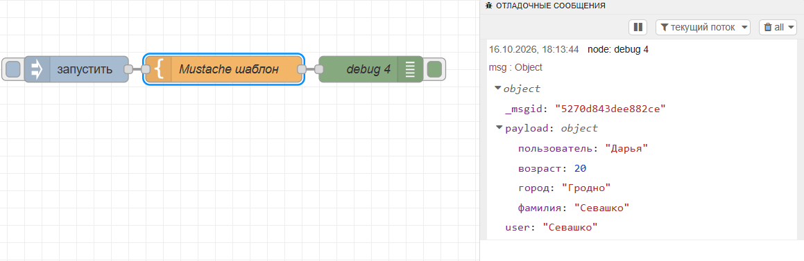

### 2.6 HTTP Request
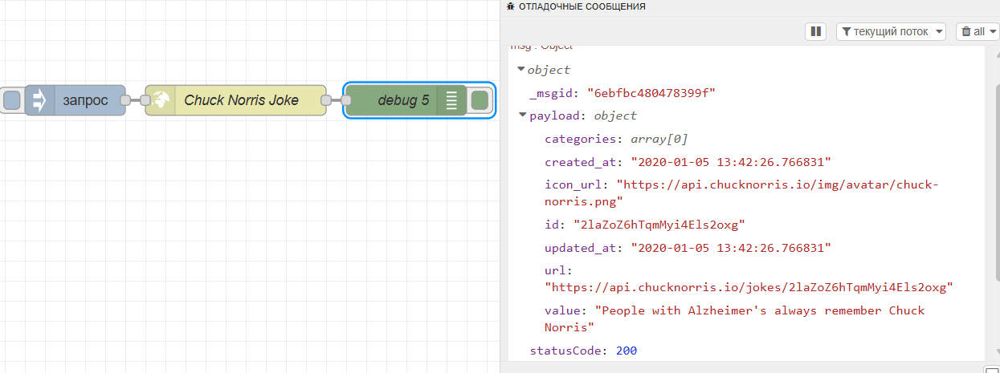

### 2.7 MQTT
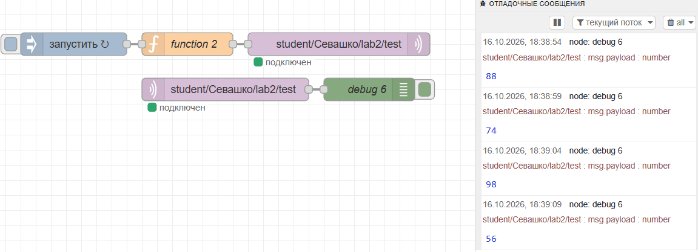

### 2.8 GET-эндпоинты

**/api/text**
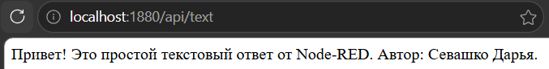

**/api/info**
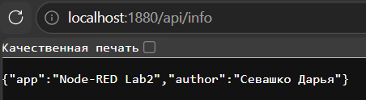

**/api/items/123 — успех**
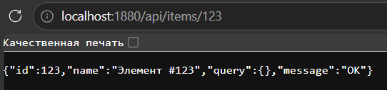

**/api/items/abc — 400**
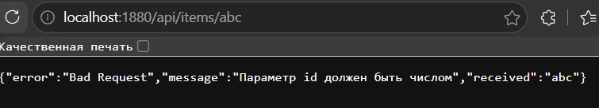

**/api/items/999 — 404**
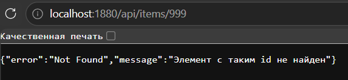

**/api/items/5?filter=name — query params**
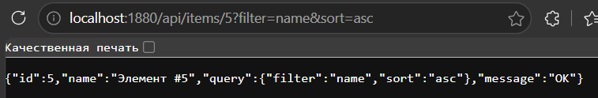

### 2.9 Dashboard

**Страница /ui**
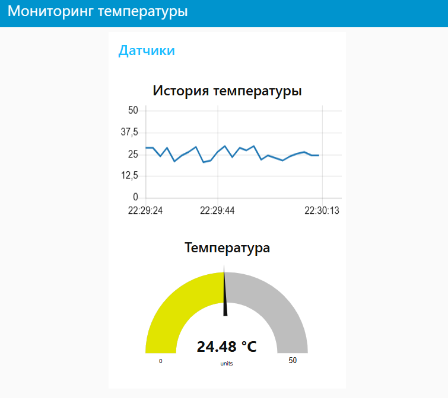

**Холст**
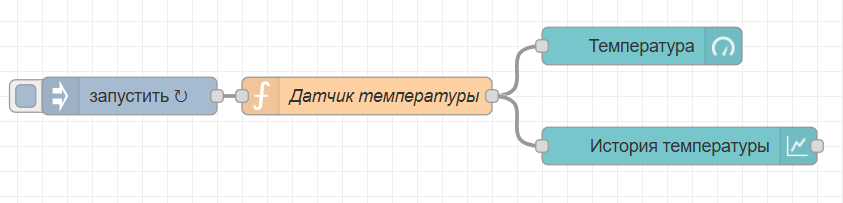

### 2.10 Telegram

**BotFather**
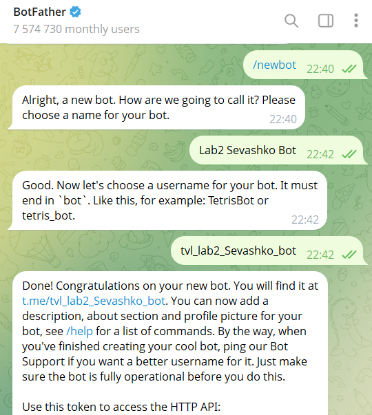

**Чат с ботом**
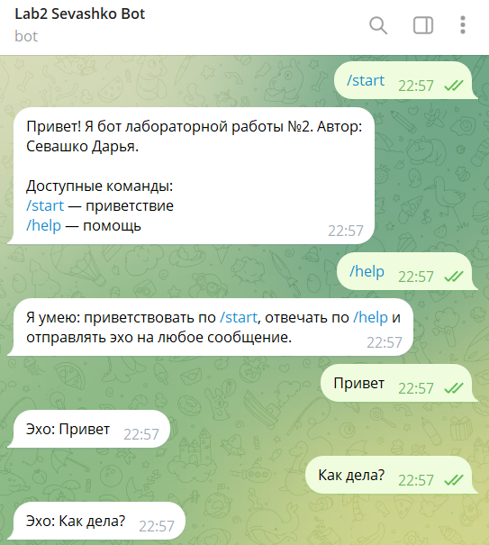

**Холст**
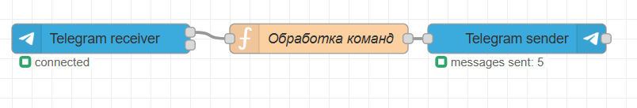

### 2.11 Файлы
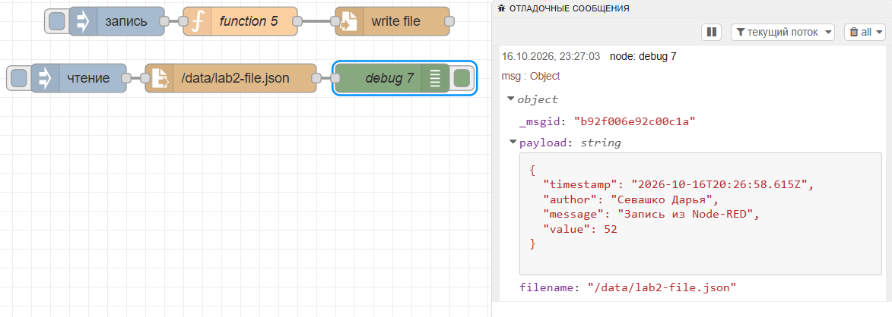

### 2.12 Контекст
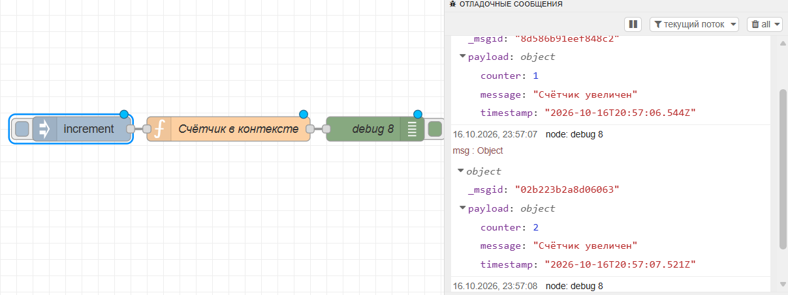
## Выводы

В ходе работы я научилась запускать Node-RED в Docker и работать с volume, чтобы данные сохранялись между перезапусками. Освоила базовые ноды (inject, debug, function, switch, change, template), научилась делать HTTP-запросы к публичным API, работать с MQTT-брокером, создавать REST-эндпоинты, дашборд с графиками, Telegram-бота, читать и записывать файлы, использовать flow context.

Самым интересным было увидеть, как из готовых блоков собирается полноценное приложение — почти без написания кода. Понравилось работать с Dashboard: gauge и chart сразу показывают результат. А также понравилось создавать GET-эндпоинты и смотреть на результаты работы прямо через браузер.

Node-RED — мощный инструмент для быстрого прототипирования. Он позволяет собрать рабочее приложение за минуты, а не часы.