# Отчёт по лабораторной работе №3 (Bubble)

## 1. Краткое описание выполненного

В ходе работы я освоила no-code платформу Bubble. С помощью встроенного AI-генератора я создала каркас веб-приложения «Каталог японской мифологии» (структура header + body + footer).

Затем я изучила Build Guides, применила идею создания карточек и внедрила её (добавила форму). Далее вручную доработала интерфейс: изменила заголовок, создала глобальную переменную цвета, применила её в стилях, добавила готовый компонент футера.

Также я спроектировала базу данных (Data Type «Мифическое существо»), добавила записи вручную и реализовала полный CRUD-цикл (Create, Read, Update, Delete) через Workflows на новых страницах, сгенерированных ИИ.

## 2. Промпт дословно (из Части 1)

> Создай приложение на тему «Каталог японской мифологии: боги и ёкаи». Пусть этот сайт будет требующий регистрацию. Страницу обязательно создай по структуре header + body + footer. Обязательно укажи в заготовке следующую строку: «ТВП: Севашко». Добавь несколько интерактивных элементов (реализующих CRUD): список мифических существ (карточки), кнопку добавления нового существа и возможность редактировать его описание.

## 3. Ссылка на dev-версию приложения

https://my-app-261023-19062.bubbleapps.io/version-test/

## 4. Какие AI-промпты использовались

1. Промпт для генерации каркаса (см. пункт 2).
2. Промпт для создания сущности в базе данных (Часть 4.1):

> Создай сущность для каталога японской мифологии. Назови её "Мифическое существо". Добавь поля: Имя (текст), Описание (текст), Изображение (картинка), Происхождение (текст), Тип (текст), Характеристики (текст).

*(Примечание: поля "Опасно" и "Источник" я добавила вручную позже, чтобы выполнить требование задания о наличии минимум 3 разных типов данных).*

## 5. Исследование Build Guides (Часть 2)

Я изучила персонализированный Build Guide «Mythical Creatures Marketplace».

**Что показалось полезным:** Использование Repeating Group для динамического вывода карточек и настройка формы для создания новых записей.

**Что взяли в приложение:** Идею «Create and edit creature listings» (создание карточек существ).

**Скриншоты исследования:**

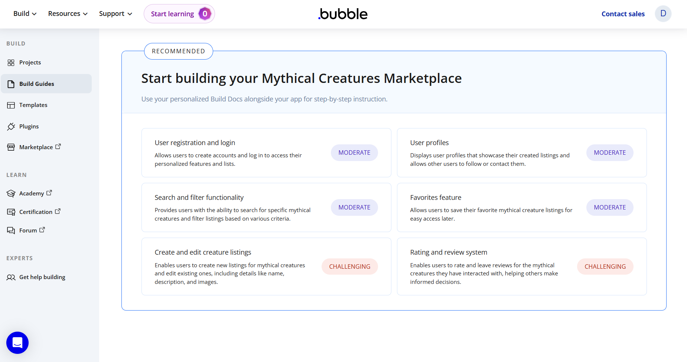

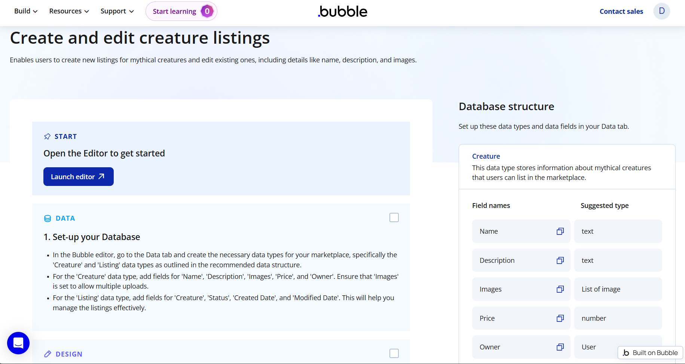

**До внедрения идеи:**

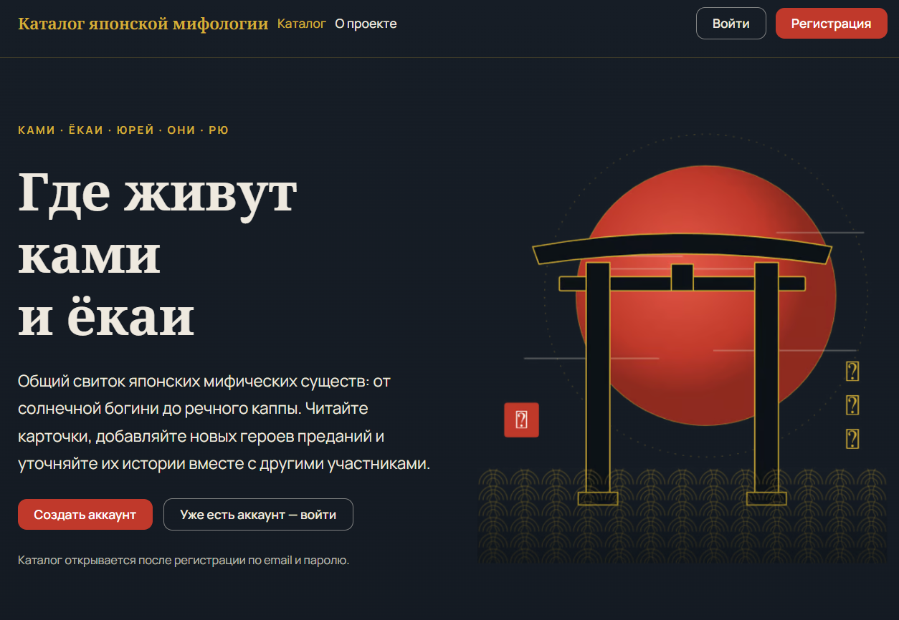

**После внедрения (добавлена форма):**

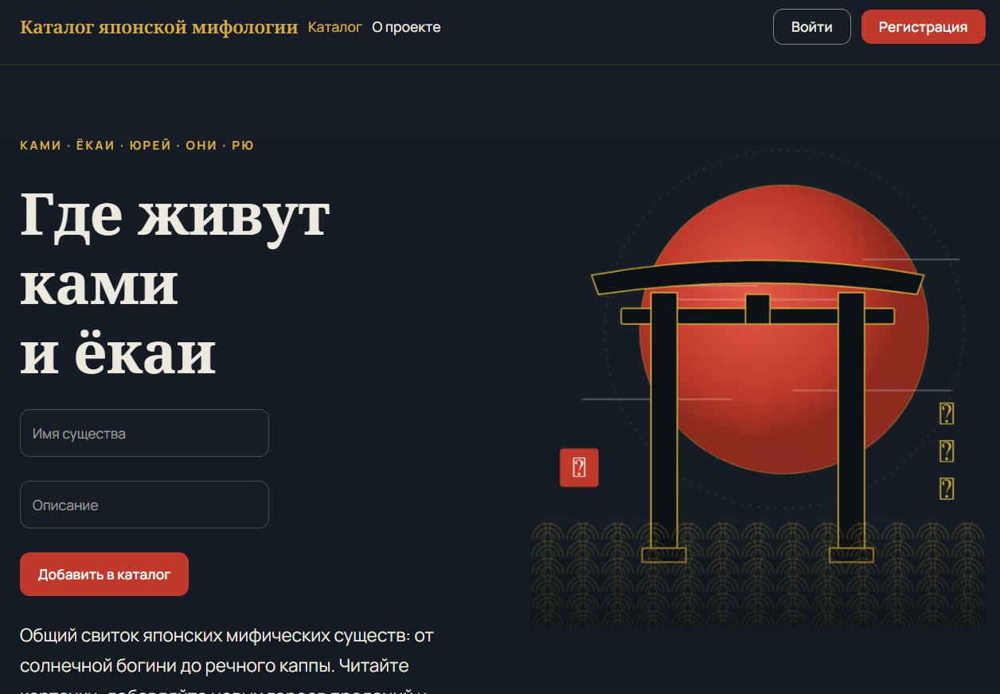

## 6. Какие элементы и workflows освоены

* **UI/Дизайн**: Работа с Global Variables (создание переменной цвета `primary-color`), создание и применение стилей (Styles), использование готовых компонентов (Components).
* **База данных**: Создание Data Type, настройка полей разных типов (text, image, date, yes/no), ручное добавление записей через App Data.
* **Workflows (CRUD)**:
    * **Create**: Workflow для кнопки «Добавить в каталог» (действие `Create a new thing`, привязка значений из Inputs).
    * **Read**: Вывод списка карточек через Repeating Group (поиск `Do a search for Мифическое существо`).
    * **Update**: Настройка кнопки «Редактировать» (открытие Popup с данными и сохранение через `Make changes to a thing`).
    * **Delete**: Настройка кнопки «Удалить» (действие `Delete a thing`, выбор `Current cell's Мифическое существо`).

## 7. Скриншоты всех шагов

### Часть 1. Промпт и генерация

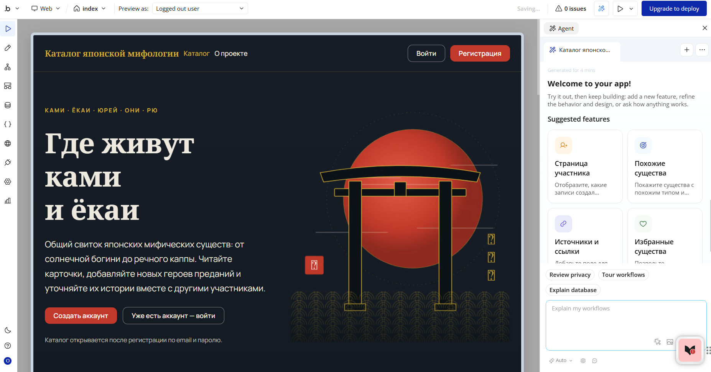

### Часть 3. Ручная доработка UI

**Global Variable (переменная цвета):**

**Создание и применение стиля:**

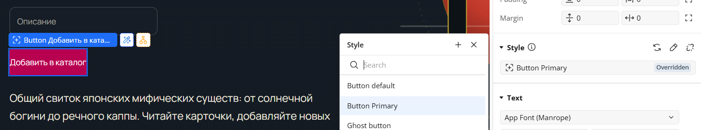

**Добавление готового компонента:**

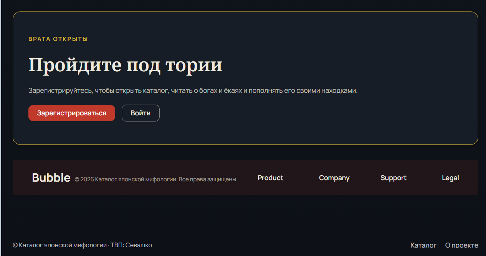

### Часть 4. Data и Workflows

**Типы данных (Data Type):**

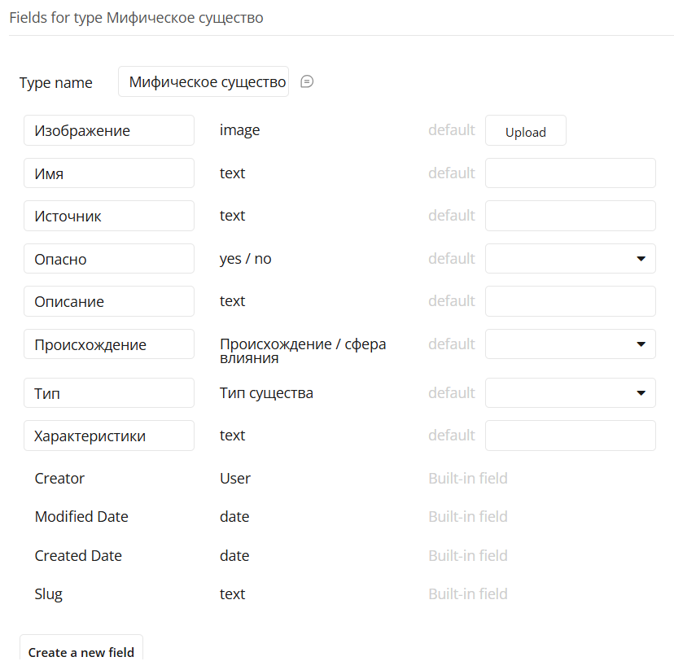

**Записи в базе данных (App Data):**

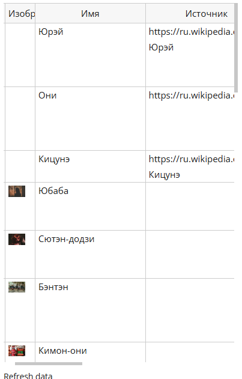

**Create (Создание) - Настройка:**

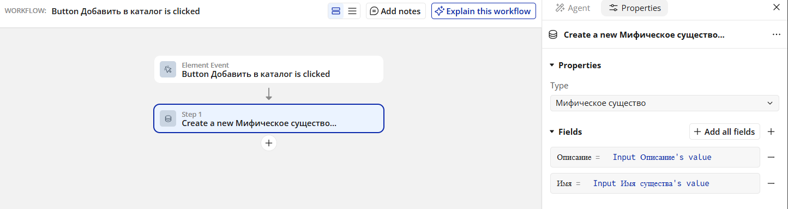

**Create (Создание) - Результат:**

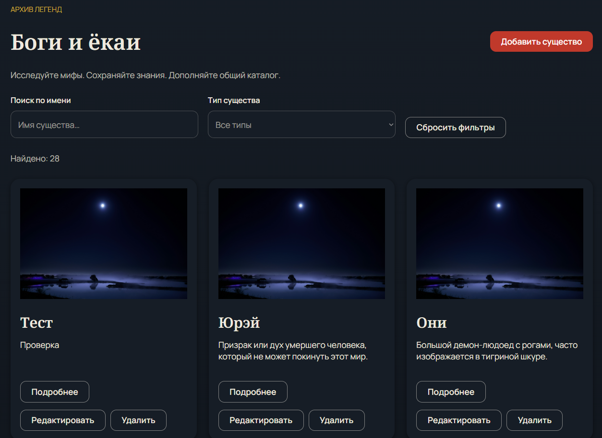

**Delete (Удаление) - Начало:**

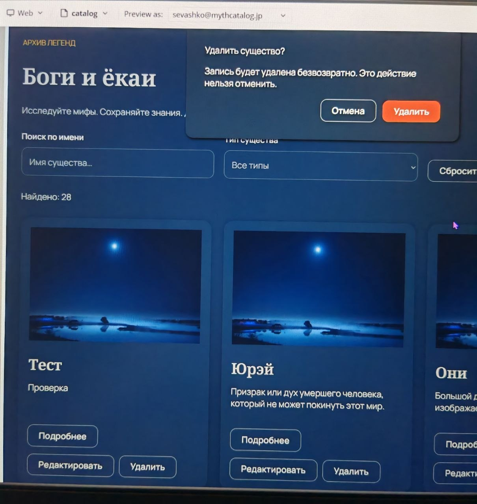

**Delete (Удаление) - Результат:**

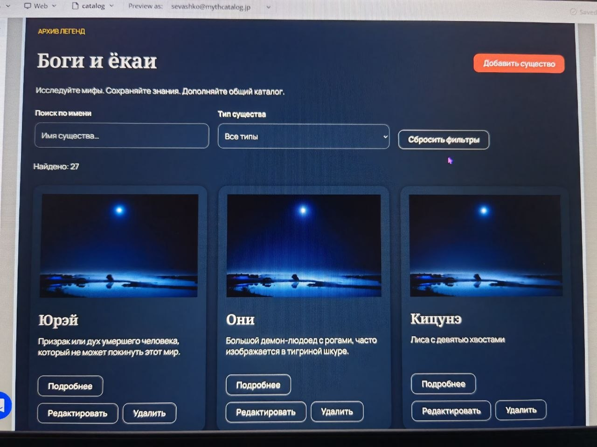

**Update (Редактирование) - Начало:**

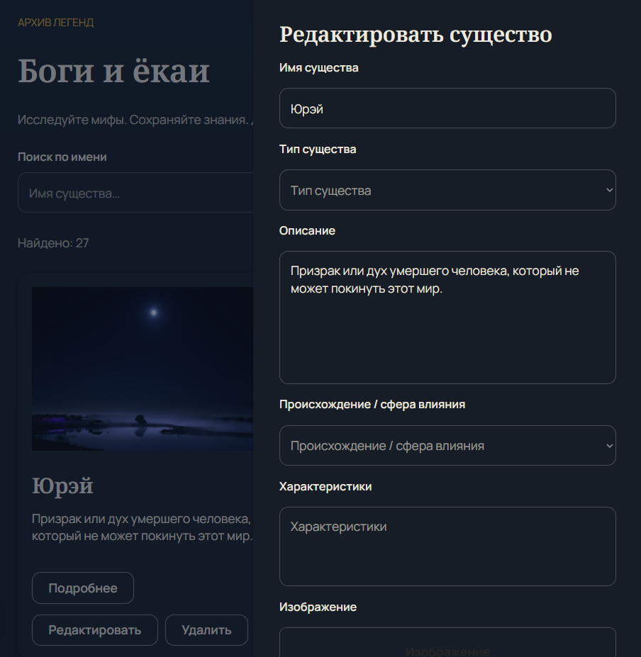

**Update (Редактирование) - Результат:**

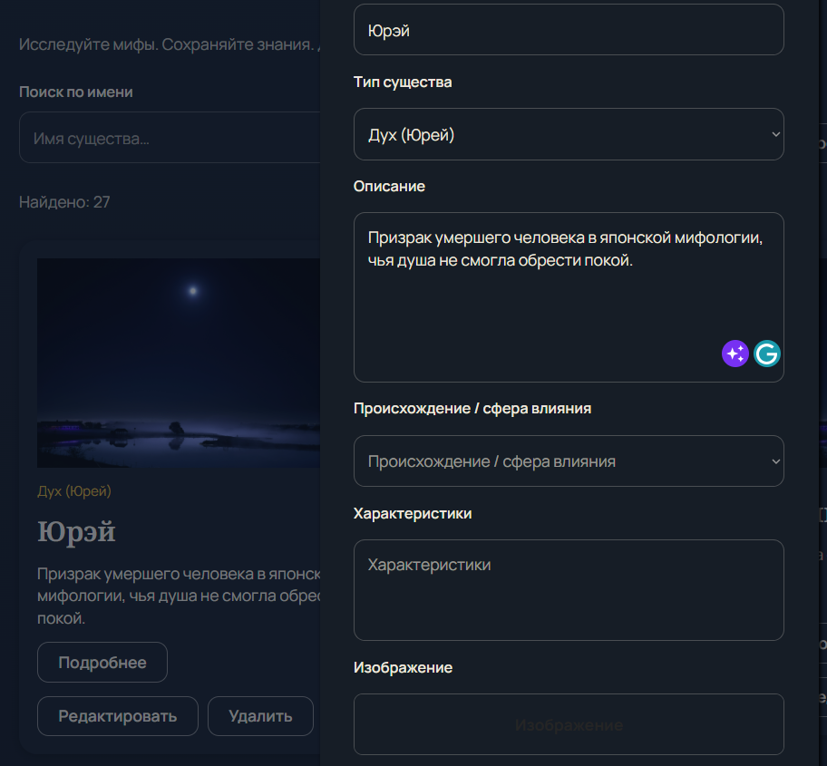

## 8. Выводы

В ходе выполнения лабораторной работы я убедилась, что Bubble — это мощный инструмент, позволяющий создавать полноценные веб-приложения без написания кода. Самым интересным было наблюдать, как AI-генератор с нуля создает красивый интерфейс по текстовому описанию. Однако я поняла, что AI не всегда связывает интерфейс с базой данных автоматически. Самым сложным и познавательным этапом стало ручное связывание полей ввода с полями Data Type и настройка Workflows для CRUD-операций. Теперь я понимаю, как работают сущности, как применять глобальные переменные для дизайна и как с помощью пары кликов настроить логику создания, чтения, обновления и удаления данных.