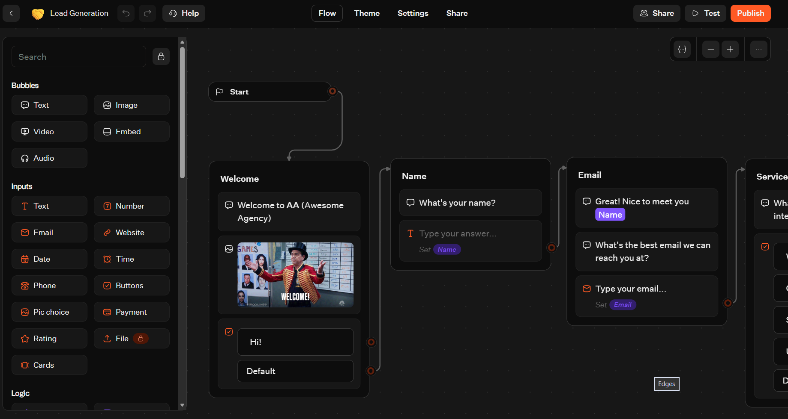
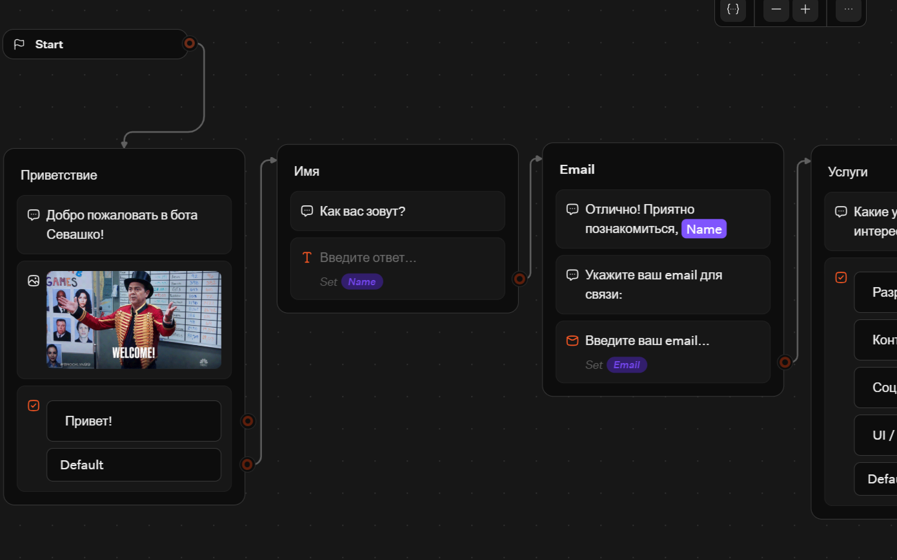
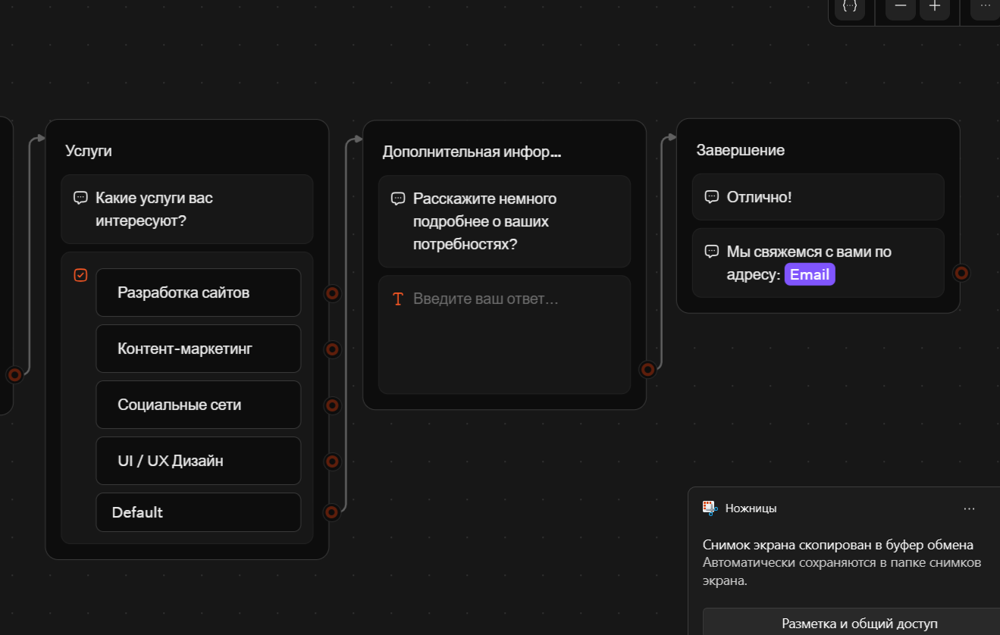
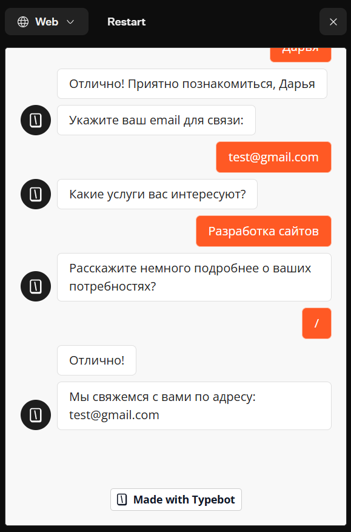
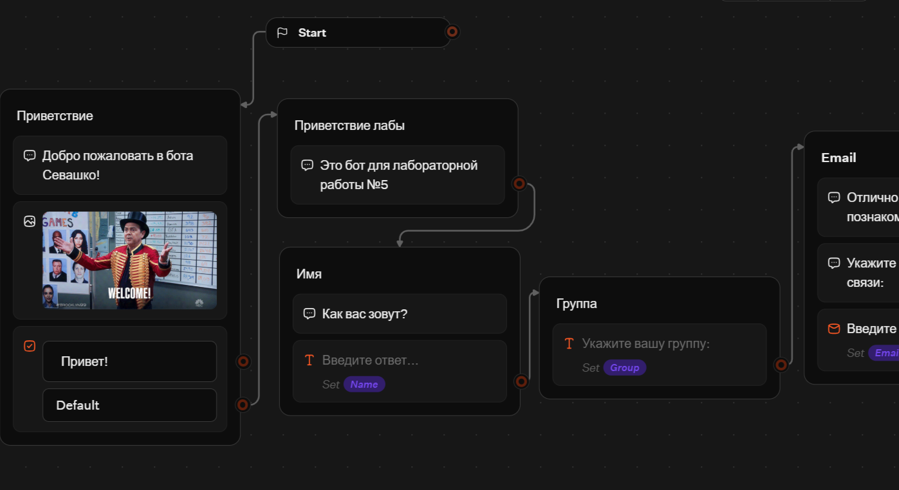
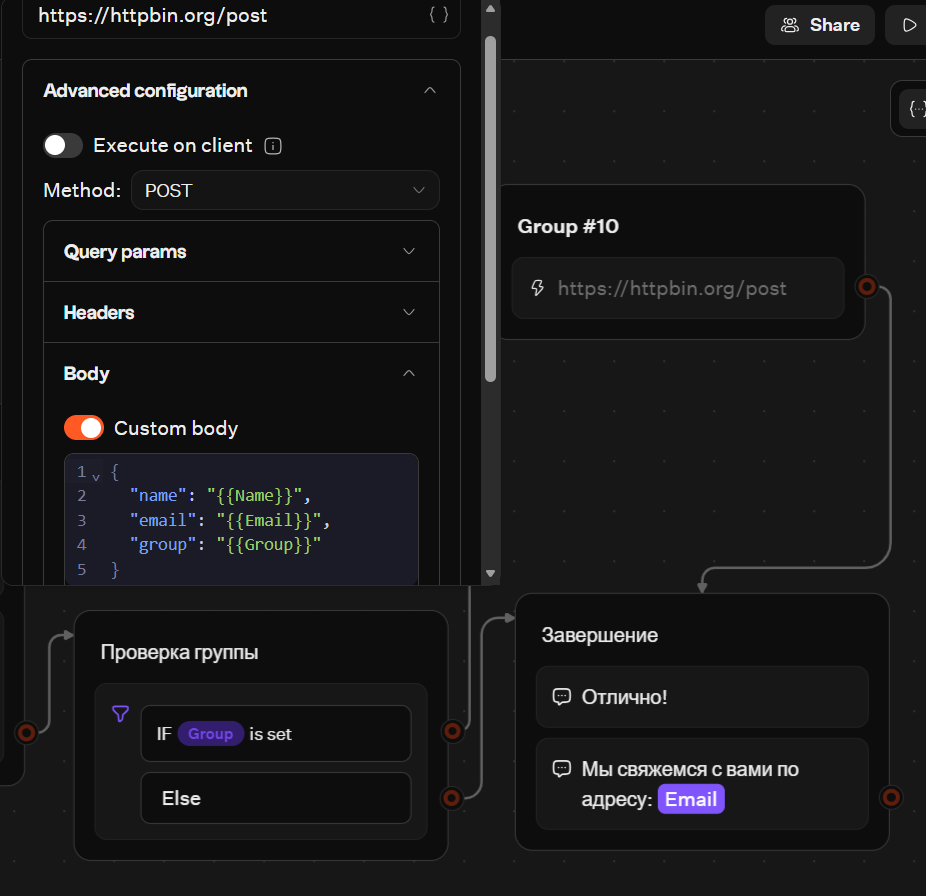
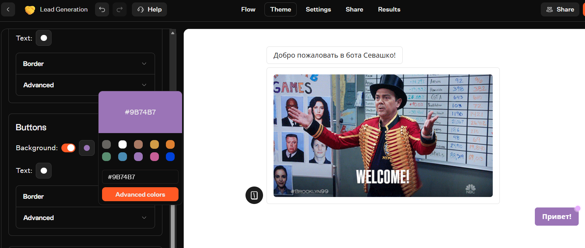
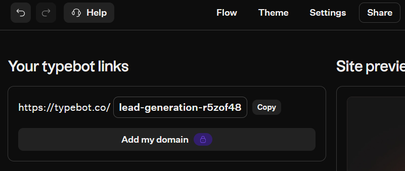

# Отчёт по лабораторной работе №5 (Чат-боты)

## 1. Краткое описание выбранного трека

Я выбрала **Трек C (TypeBot)**. Для выполнения работы я зарегистрировалась в TypeBot Cloud, создала рабочее пространство `lab5-Sevashko` и выбрала шаблон **Lead Generation** в качестве основы. 

В ходе работы я полностью русифицировала интерфейс бота, добавила новые блоки (сбор группы, информационный текст), настроила условие (Condition),(Variable), интеграцию с внешним сервером через HTTP Request, а также изменила цветовую тему (брендинг). Экспорт flow в JSON выполнен успешно.

## 2. Ссылка на бота и файл экспорта

**Ссылка на работающего бота:** [https://typebot.co/lead-generation-r5zof48](https://typebot.co/lead-generation-r5zof48)

**Файл экспорта:** лежит в папке `exports/flow-01-sevashko.json`.

## 3. Какие AI-промпты использовались

1. «Как в TypeBot настроить HTTP Request?»
2. «Какой URL использовать для проверки HTTP Request?»

## 4. Какие блоки/ноды/элементы освоены

* **Блоки ввода (Inputs)**: Text, Email (сбор имени, почты, группы).
* **Условие (Condition)**: проверка, что переменная `Group` не пустая.
* **Переменные (Variables)**: создание и использование переменной `Group` (а также стандартных `Name` и `Email`).
* **Интеграция (HTTP Request)**: отправка POST-запроса с данными пользователя на сервер `httpbin.org`.
* **Темы (Theme)**: смена основного цвета кнопок (Primary color) на фиолетовый.

## 5. Скриншоты всех workflow и диалогов

**Скриншот «До» (шаблон на английском):**

**Скриншот «После» (русификация и новые блоки):**

**Тест работы бота на русском:**

**Добавленные элементы (Группа, Условие, HTTP Request):**

**Смена темы (Брендинг):**

**Ссылка на бота:**

## 6. Выводы

В ходе выполнения лабораторной работы я освоила платформу TypeBot для создания чат-ботов. Самым интересным этапом была русификация шаблона — важно было не удалить системные переменные, чтобы не сломать логику. Также я научилась настраивать Condition (условия) и HTTP Request для отправки данных на внешний сервер, что позволяет интегрировать бота с любыми CRM-системами и тд. TypeBot оказался очень интуитивным инструментом, который позволяет быстро создавать сложные сценарии без написания кода. Достаточно комфортно было работать.