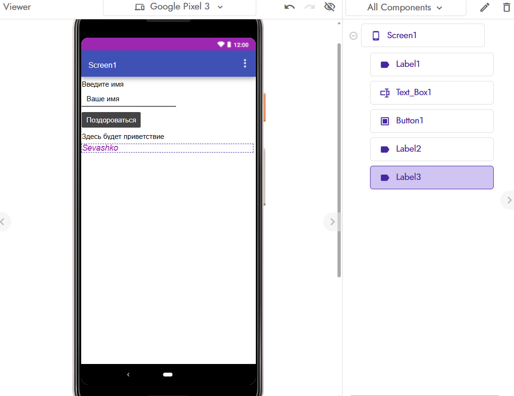
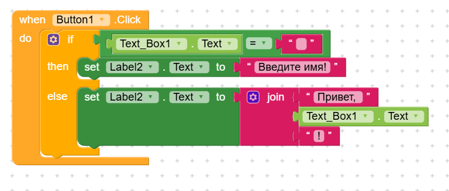

# Отчёт по лабораторной работе №6 (Kodular)

## 1. Краткое описание приложения и ачивок

В ходе работы я создала простое мобильное приложение «Приветствие» на платформе Kodular. Приложение состоит из одного экрана (Screen1), на котором размещены:
* Заголовок «Введите имя».
* Поле для ввода имени (TextBox с подсказкой «Ваше имя»).
* Кнопка «Поздороваться».
* Текстовый блок для вывода результата.
* Обязательный Label с моей фамилией на английском языке (**Sevashko**), видимый на экране.

**Логика работы (блоки):** При нажатии на кнопку «Поздороваться» срабатывает условие `if/else`. Оно проверяет, пустое ли поле ввода. Если пользователь ничего не ввел, выводится сообщение «Введите имя!». Если имя введено, с помощью блока `join` формируется строка «Привет, [Имя]!», которая выводится в текстовый блок.

*Дополнительные возможности (ачивки) в данной работе не реализовывались.*

## 2. Ссылка на проект или файл .aia

Исходный код проекта экспортирован и сохранен в репозитории по пути: `exports/lab6-Sevashko.aia`.

## 3. Использованные AI-промпты

1. «Как в Kodular сделать так, чтобы при нажатии на кнопку проверялось, пустое ли текстовое поле, и выводилось сообщение?»
2. «Какой блок в Kodular отвечает за склеивание строк? Как использовать блок join для создания приветствия с именем?»
3. «Как поменять ширину элемента Label в Kodular, чтобы текст не налезал друг на друга?»

## 4. Какие компоненты и блоки освоены

* **Компоненты интерфейса:** Label (текстовые метки), TextBox (поле ввода), Button (кнопка).
* **Блоки управления (Control):** `when Button.Click` (обработчик нажатия), `if/then/else` (условное ветвление).
* **Логические блоки:** блок сравнения `=` и `≠` (для проверки пустоты строки).
* **Текстовые блоки:** `join` (объединение нескольких строк в одну).
* **Блоки компонентов:** `set Label.Text to` (изменение текста метки).

## 5. Скриншоты всех экранов и логики

**Скриншот экрана дизайнера (Screen1) с видимой фамилией:**

**Скриншот блоков (логики) с if/else и join:**

## 6. Ограничения бесплатного тарифа Kodular

При работе на бесплатном тарифе я столкнулась со следующими ограничениями:
* Лимит на количество проектов (до 10).
* Ограничение размера загружаемых ассетов (до 10 МБ).
* Возможность использовать не более 5 сторонних расширений (extensions).
* В бесплатной версии может быть ограничена возможность прямого экспорта `.aia` (в некоторых обновлениях платформы эта кнопка скрыта или требует подписки, поэтому я сохраняла проект через меню `Project -> Export selected project`).

## 7. Выводы

В ходе выполнения лабораторной работы я освоила основы визуального программирования в среде Kodular. Я научилась создавать пользовательский интерфейс из визуальных компонентов (Label, TextBox, Button) и настраивать их свойства.

Самым интересным было писать логику в виде блоков. В отличие от обычного кода, где нужно писать текст, здесь блоки соединяются как пазлы, что делает процесс наглядным. Я поняла, как работают условные конструкции (if/else), как проверять данные на пустоту и как склеивать строки с помощью блока `join`. Также я убедилась, что Kodular отлично подходит для быстрого создания простых Android-приложений без глубоких знаний программирования.