# Отчёт по лабораторной работе №7 (Notion)

## 1. Краткое описание предметной области и модели данных

В качестве предметной области я выбрала «Базу знаний по Японской мифологии». Модель данных состоит из 3 связанных сущностей:

1. **Боги (Ками):** хранит имена богов, их сферу влияния (Небо, Море, Война) и дату упоминания.
2. **Мифические существа:** содержит существ (Ёкаи, Демоны, Духи), их тип, уровень опасности и связь с богом-покровителем.
3. **Легенды:** включает названия легенд, дату записи, связь с конкретным существом и вычисляемое поле «Год записи» (Formula).

**Связи:** База «Существа» связана с «Богами» (какое существо какому богу подчиняется) и с базой «Легенды» (в какой легенде упоминается существо).

## 2. Промпт для ИИ и что было исправлено

**Промпт:**
> *«Придумай модель данных для Notion на тему "Личная библиотека". Нужно 3 связанные сущности. У каждой должно быть минимум 3 свойства разных типов (Title, Select, Date, Number). Обязательно добавь минимум 2 связи типа Relation (например, Книги связаны с Авторами и с Полками). Также предложи одну формулу (Formula) для подсчёта и одно простое действие для кнопки (Button)».*

**Что исправлено после проверки:**
Изначально ИИ предложил модель для библиотеки, но я адаптировала её под свою уникальную тему (Японская мифология). Я заменила сущности на «Боги», «Существа» и «Легенды», добавила специфические свойства (Сфера влияния, Опасность) и настроила связи между ними.

## 3. Перечень реализованных ачивок

**Ачивка 2: Продвинутая кнопка (с условной логикой if).**
Я создала кнопку «Успокоить/Приручить», которая меняет уровень опасности существа на 1. Однако она срабатывает **только при условии**, что текущая опасность существа больше 5. Если нажать кнопку у безопасного существа, ничего не произойдет.

**Скриншоты Ачивки 2:**

Настройка условия (Опасность > 5):
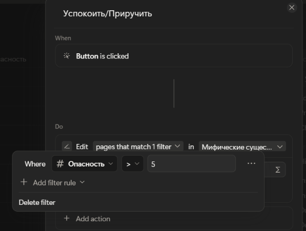

Настройка действия (Опасность = 1):
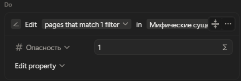

Результат работы кнопки:
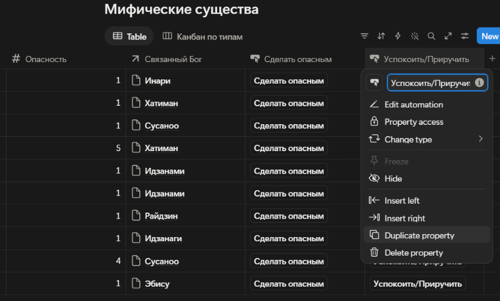

## 4. Ссылка на опубликованную страницу

[Открыть страницу в Notion](ВСТАВЬТЕ_СЮДА_ВАШУ_ССЫЛКУ_ИЗ_SHARE)

## 5. Использованные AI-промпты

1. «Придумай модель данных для Notion на тему "Японская мифология". Нужно 3-4 сущности, свойства типов Title, Select, Date, Number, Relation, Formula».
2. «Как в Notion настроить связь Relation между двумя базами данных?»
3. «Как создать кнопку в Notion, которая срабатывает только при определенном условии (if)?»
4. «Как опубликовать страницу Notion в интернет и получить ссылку?»

## 6. Освоенные компоненты и настройки Notion

*   **Базы данных:** Создание баз, настройка свойств (Title, Text, Select, Number, Date, Relation, Formula, Checkbox, Button).
*   **Связи (Relation):** Настройка связей между базами Боги-Существа и Существа-Легенды.
*   **Формулы (Formula):** Использование функции `year()` для извлечения года из даты.
*   **Кнопки (Button):** Настройка автоматизации с фильтрами (условиями if).
*   **Представления (Views):** Создание таблицы (Table) и канбан-доски (Board), группировка по свойству «Тип».
*   **Публикация:** Экспорт страницы в веб (Publish to web).

## 7. Скриншоты базовой части

**Главная страница с фамилией:**
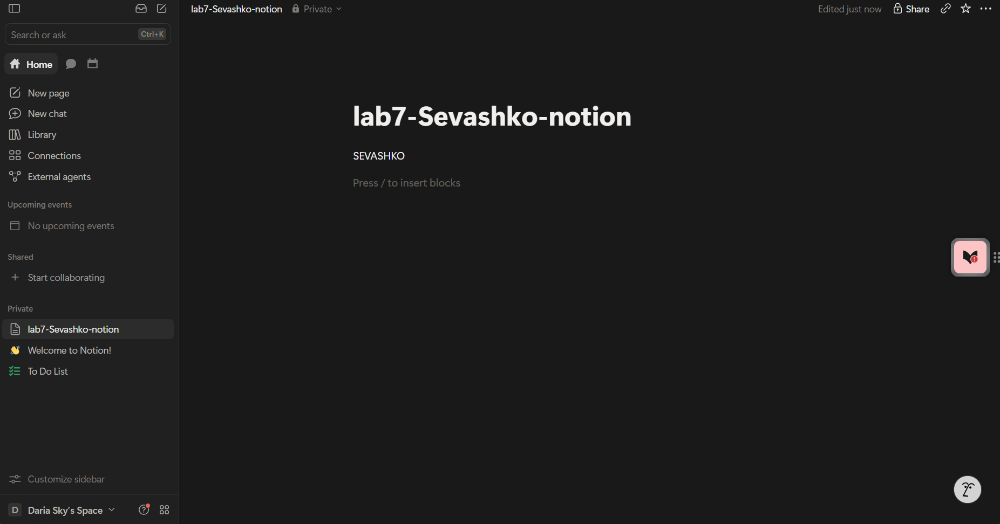

**База данных «Боги (Ками)»:**
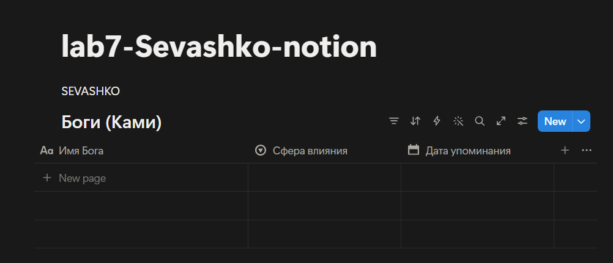

**База данных «Мифические существа» и настройка связи Relation:**
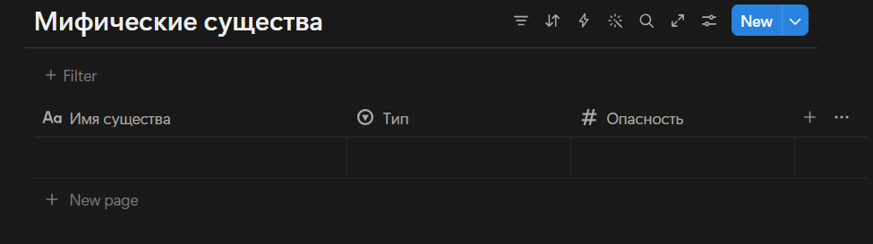
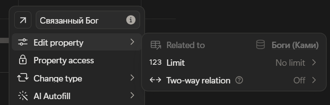

**База данных «Легенды» и настройка формулы:**
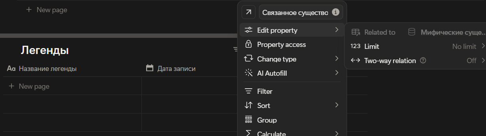
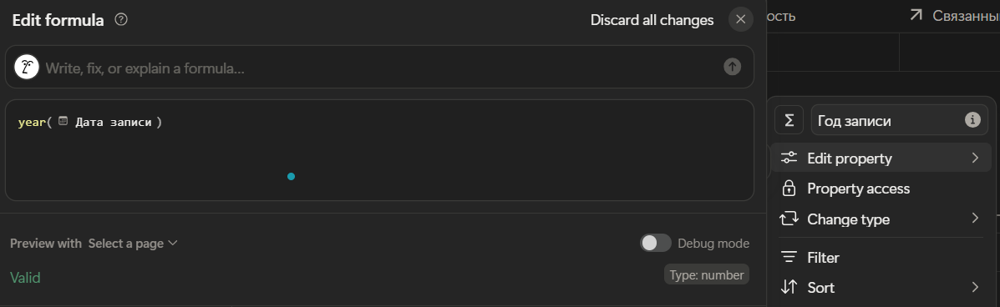

**Заполненные данными базы:**
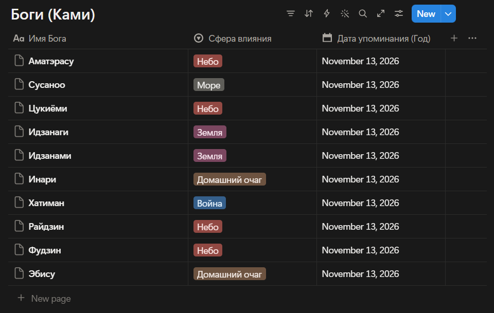
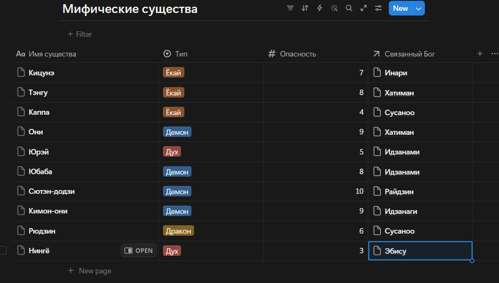
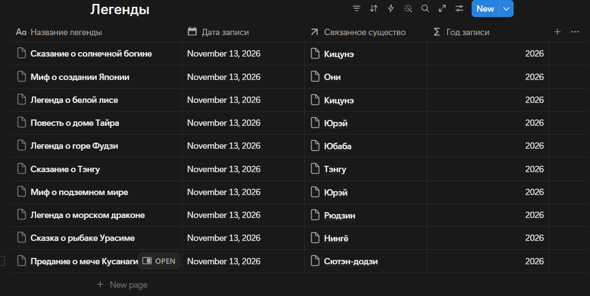

**Базовая кнопка:**

**Представление Канбан:**
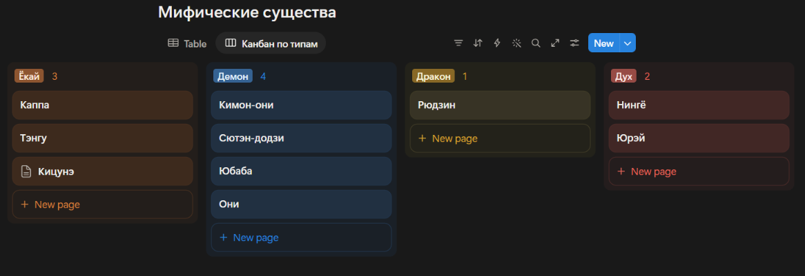

**Публикация страницы:**
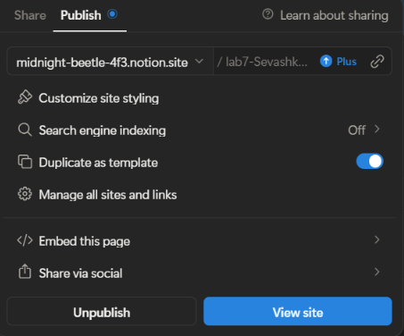

## 8. Ограничения бесплатного тарифа

*   Ограничение на размер загружаемых файлов (до 5 МБ).
*   Отсутствие полной истории версий (доступно только 7 дней).
*   Ограничение на количество гостей в рабочем пространстве.

## 9. Выводы

В ходе выполнения лабораторной работы я освоила создание баз данных и настройку связей в Notion. Самым интересным было работать с формулами и кнопками: я поняла, как создавать вычисляемые свойства и настраивать автоматизацию с условиями (if). Notion оказался очень гибким инструментом, который позволяет создавать сложные системы для управления данными без программирования.